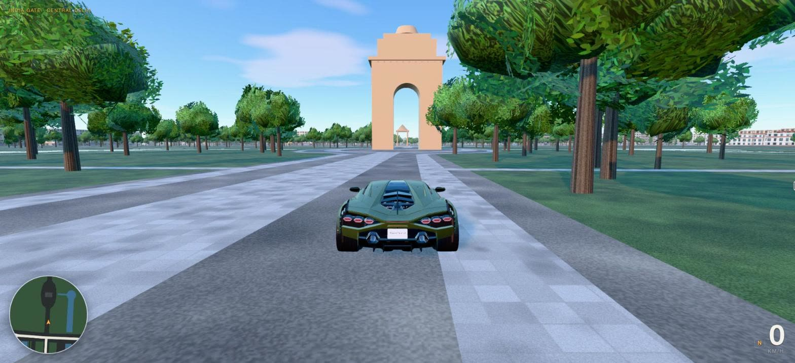
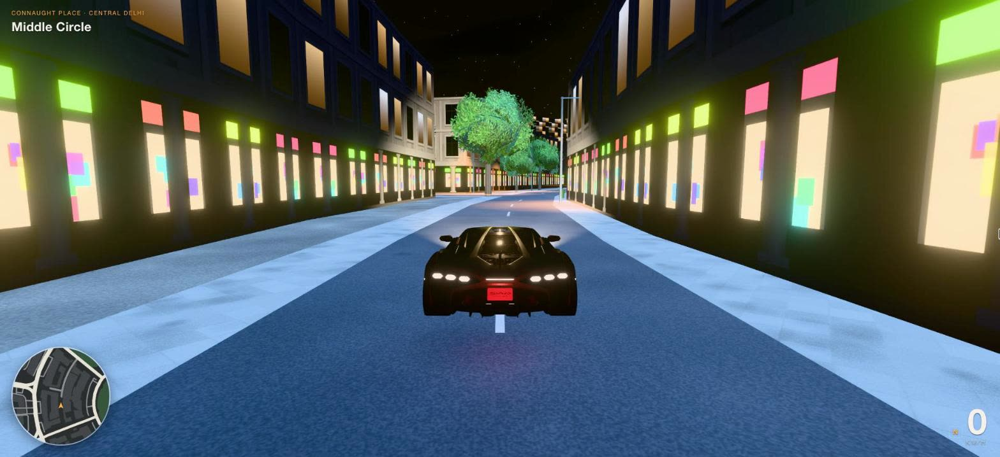
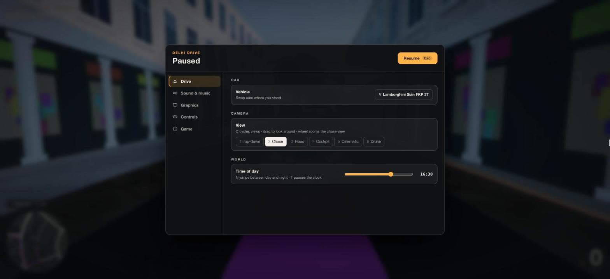

# Delhi Drive

**Drive through real Central Delhi in your browser.** Connaught Place, India Gate, Kartavya Path and Lutyens' Delhi, built street by street from OpenStreetMap. Day and night, GPS waypoints, real car sounds and your own music. No install, no sign-up.

**▶ Play now: [gta-ncr-ro.vercel.app](https://gta-ncr-ro.vercel.app/)**



| Connaught Place by day | …and by night |
|---|---|
|  |  |
| **Cockpit view, cabin lights on** | **Pause menu** |
|  |  |

## What's in it

- **The real city.** Roads, buildings, parks and trees of central New Delhi come from OpenStreetMap. Connaught Place's white Georgian colonnades, the red sandstone ministries, India Gate and the 63 m flag over Central Park are all built in.
- **Day and night.** A full day passes in 24 minutes, or jump to night with N. After dark the sodium street lamps, shop signs and office windows come on, headlights switch on by themselves, and the cabin glows.
- **Two cars.** A Lamborghini Sián FKP 37 and a Mercedes-AMG G 63, with real suspension and grip (Rapier physics). Switch with V.
- **Six cameras.** Chase, hood, cockpit, top-down, cinematic and a free drone. Drag to look around and use the wheel to zoom.
- **GPS.** Open the map (M), click anywhere or pick a landmark, and follow the purple route along the roads. One-way streets are respected.
- **Sound.** Recorded engine, tyre squeal, crashes and horn. Paste any YouTube video or playlist link into the menu to drive to your own music.
- **Knock things over.** Bins, barricades and parked autos fly when you hit them. Trees and lamp posts don't move.
- **Runs anywhere.** WebGPU where the browser has it, WebGL 2 otherwise. Four quality presets, a resolution governor that holds the frame rate, and game controller support.
- **Saves as you go.** Your place, car, clock and waypoint are kept in the browser.

## Controls

| Keyboard & mouse | | Controller | |
|---|---|---|---|
| <kbd>W A S D</kbd> / arrows | drive and steer | <kbd>RT</kbd> · <kbd>LT</kbd> | accelerate · brake and reverse |
| <kbd>Space</kbd> | handbrake | Left stick / d-pad | steer |
| <kbd>H</kbd> (hold) | horn | Right stick | look around |
| <kbd>L</kbd> | headlights | <kbd>A</kbd> ✕ | handbrake |
| <kbd>R</kbd> | back onto the road | <kbd>X</kbd> □ | horn |
| <kbd>V</kbd> | switch car | <kbd>B</kbd> ○ | back onto the road |
| <kbd>C</kbd> · <kbd>1</kbd>–<kbd>6</kbd> | next camera · pick one | <kbd>Y</kbd> △ | next camera |
| Drag · wheel | look around · zoom | <kbd>LB</kbd> · <kbd>RB</kbd> | switch car · headlights |
| <kbd>M</kbd> | map and GPS waypoint | D-pad ↑ · ↓ | pause clock · map |
| <kbd>N</kbd> · <kbd>T</kbd> | day / night · pause the clock | View · Menu | day / night · pause menu |
| <kbd>Esc</kbd> | pause menu | | |

Browsers only allow game controllers on `https://` or `localhost` pages.

## Run it locally

Needs Node 20.19 or newer.

```bash
npm install
npm run dev          # http://localhost:5180
npm run build        # type-check and build to dist/
npm run preview      # serve the build
npm run dev:https    # https on your network, so a phone or another PC can use a controller
```

### Handy URL options

| Option | Effect |
|---|---|
| `?q=low\|medium\|high\|ultra` | graphics preset (overrides the menu) |
| `?time=22` | start at 10 pm; `?speed=0` freezes the clock |
| `?car=g63` | start in the G 63 |
| `?cam=cockpit` | start in a camera view |
| `?x=…&z=…&h=…` | start anywhere on the map (metres from Connaught Place, heading in degrees) |
| `?fresh` | ignore saved progress |
| `?gl` | force WebGL 2 instead of WebGPU |

## How it's built

- **[three.js](https://threejs.org/)** (WebGPU renderer and TSL node materials) for graphics: cascaded sun shadows, bloom, a physical sky, and street lamps lit from the nearest poles.
- **[Rapier](https://rapier.rs/)** for physics: a ray-cast vehicle, building walls as triangle meshes, and street furniture that sleeps until hit.
- **TypeScript + [Vite](https://vite.dev/)**, with no UI framework.
- **The map** is baked from OpenStreetMap (Overpass) by `tools/bake/bake.mjs` into 1 km cells under `public/tiles/`. Cells load and unload around the car as you drive.
- **Sound** uses the Web Audio API. Recorded loops are pitched and filtered live, and music plays through the YouTube IFrame Player API.

```
src/
  main.ts            game loop, input wiring, menu
  world/             map cells, roads, buildings, trees, lamps, physics, GPS routing
  vehicle/           car specs, physics, models, lights, input
  camera/            the six camera modes
  render/            renderer, post-processing, sky and day/night
  audio/             car sounds and YouTube music
  hud/               speedometer, minimap, big map, menu
tools/bake/          OpenStreetMap → tiles
tools/dev/           small self-checks (node tools/dev/<name>.ts)
```

## Credits

- **Map data** © [OpenStreetMap](https://www.openstreetmap.org/copyright) contributors, ODbL.
- **Lamborghini Sián FKP 37** model by [Ddiaz Design](https://sketchfab.com/ddiaz-design), CC BY 4.0.
- **Mercedes-AMG G 63** model by [Ddiaz Design](https://sketchfab.com/ddiaz-design), CC BY-NC-SA 4.0 (non-commercial use only).
- **Engine sound** "Car Engine Loop" by qubodup ([OpenGameArt](https://opengameart.org/content/car-engine-loop-96khz-4s)), CC BY 3.0.
- **Tyre, horn and crash sounds** from [freesound.org](https://freesound.org) (CC0) by audible-edge, keweldog, qubodup, squareal and magnuswaker. See [`public/sounds/CREDITS.txt`](public/sounds/CREDITS.txt).
