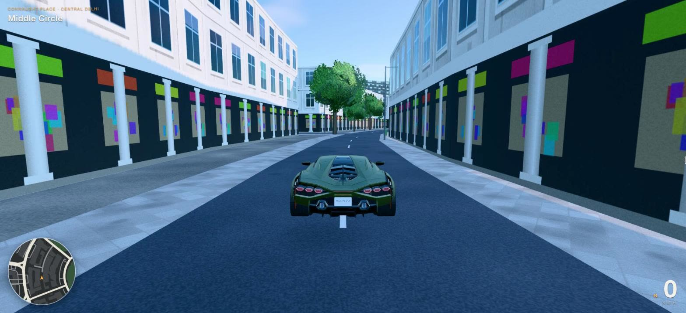
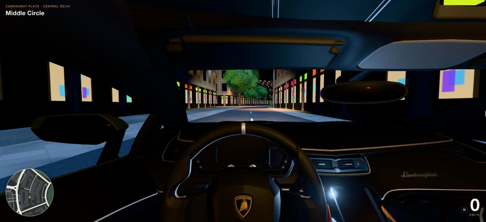

# Delhi Drive

**Drive through real Delhi in your browser.** About 240 km² of it, from the Red Fort and Old Delhi to Hauz Khas, and from Karol Bagh to the Yamuna, with Connaught Place, India Gate and Lutyens' Delhi at the centre. Built street by street from OpenStreetMap. Day and night, GPS waypoints, real car sounds and your own music. No install, no sign-up.

**▶ Play now: [gta-ncr-ro.vercel.app](https://gta-ncr-ro.vercel.app/)**


| Connaught Place by day | …and by night |
|---|---|
|  |  |
| **Cockpit view, cabin lights on** | **Pause menu** |
|  |  |

## What's in it

- **The real city.** Roads, buildings, parks and trees of Delhi come from OpenStreetMap. Connaught Place's white Georgian colonnades, the red sandstone ministries, India Gate and the 63 m flag over Central Park are all built in.
- **And South Bombay.** A second map, from Bandra over the Bandra–Worli Sea Link, down the Coastal Road and Marine Drive to the Fort, the Gateway of India, the Taj and Colaba, with the Arabian Sea round it. Pick it on the title screen, or open `?city=mumbai`.
- **Day and night.** A full day passes in 24 minutes, or jump to night with N. After dark the sodium street lamps, shop signs and office windows come on, headlights switch on by themselves, and the cabin glows.
- **Four cars and a bike.** A Lamborghini Sián FKP 37, a Mercedes-AMG G 63, a Mahindra Thar, a Hyundai Creta and a KTM 390 Duke, each with someone at the wheel (or on the saddle), on real suspension (Rapier physics) and tyres that slip: wheels spin and lock, the anti-lock brakes pulse, weight shifts under braking, the handbrake swings the tail out, accelerate and brake together powerslide it, and the tall G 63 leans and can go over. Switch with V.
- **Six cameras.** Chase, hood, cockpit, top-down, cinematic and a free drone. Drag to look around and use the wheel to zoom.
- **GPS.** Open the map (M), click anywhere or pick a landmark, and follow the purple route along the roads. One-way streets are respected.
- **Sound.** Recorded engine, tyre squeal, crashes and horn. Paste any YouTube video or playlist link into the menu to drive to your own music.
- **Knock things over.** Bins, barricades, lamp posts and traffic signals go flying or topple when you hit them. Trees don't move.
- **Runs anywhere.** WebGPU where the browser has it, WebGL 2 otherwise. Four quality presets, a resolution governor that holds the frame rate, and game controller support.
- **Saves as you go.** Your place, car, clock and waypoint are kept in the browser.

## Controls

| Keyboard & mouse | | Controller | |
|---|---|---|---|
| <kbd>W A S D</kbd> / arrows | drive and steer | <kbd>RT</kbd> · <kbd>LT</kbd> | accelerate · brake and reverse |
| <kbd>W</kbd> + <kbd>S</kbd> (hold, steer) | drift | <kbd>RT</kbd> + <kbd>LT</kbd> (hold, steer) | drift |
| <kbd>Space</kbd> | handbrake | Left stick / d-pad | steer |
| <kbd>H</kbd> (hold) | horn | Right stick | look around |
| <kbd>L</kbd> | headlights | <kbd>A</kbd> ✕ | handbrake |
| <kbd>R</kbd> | back onto the road | <kbd>X</kbd> □ | horn |
| <kbd>V</kbd> | switch car | <kbd>B</kbd> ○ | back onto the road |
| <kbd>C</kbd> · <kbd>1</kbd>–<kbd>6</kbd> | next camera · pick one | <kbd>Y</kbd> △ | next camera |
| Drag · wheel | look around · zoom | <kbd>LB</kbd> · <kbd>RB</kbd> | switch car · headlights |
| <kbd>M</kbd> | map and GPS waypoint | D-pad ↑ · ↓ | pause clock · map |
| <kbd>N</kbd> · <kbd>T</kbd> | day / night · pause the clock | View · Menu | day / night · pause menu |
| <kbd>Esc</kbd> | pause menu | | |

Browsers only allow game controllers on `https://` or `localhost` pages.

## Run it locally

Needs Node 20.19 or newer.

```bash
npm install
npm run dev          # http://localhost:5180
npm run build        # type-check and build to dist/
npm run preview      # serve the build
npm run dev:https    # https on your network, so a phone or another PC can use a controller
```

### Handy URL options

| Option | Effect |
|---|---|
| `?q=low\|medium\|high\|ultra` | graphics preset (overrides the menu) |
| `?time=22` | start at 10 pm; `?speed=0` freezes the clock |
| `?car=g63` | start in the G 63 (also `thar`, `creta`, `ktm-390-duke`) |
| `?cam=cockpit` | start in a camera view |
| `?x=…&z=…&h=…` | start anywhere on the map (metres from Connaught Place, heading in degrees) |
| `?city=mumbai` | drive South Bombay instead of Delhi (each city keeps its own save) |
| `?fresh` | ignore saved progress |
| `?gl` | force WebGL 2 instead of WebGPU |

## How it's built

- **[three.js](https://threejs.org/)** (WebGPU renderer and TSL node materials) for graphics: cascaded sun shadows, bloom, a physical sky, and street lamps lit from the nearest poles.
- **[Rapier](https://rapier.rs/)** for physics: sprung ray-cast wheels with the game's own tyre model on top (`src/vehicle/vehicle.ts`), building walls as triangle meshes, and street furniture that sleeps until hit.
- **Only the vicinity is drawn.** Each 1 km map cell is cut into 200 m chunks; chunks beyond the preset's draw distance are taken out of the scene and haze hides the edge. The pause menu's Graphics tab shows which graphics card the browser is using.
- **TypeScript + [Vite](https://vite.dev/)**, with no UI framework.
- **The map** is baked from OpenStreetMap (Overpass) by `tools/bake/bake.mjs` into 1 km cells under `public/tiles/`. South Bombay (`--area mumbai`) is cut from Geofabrik's India extract instead, with [osmium-tool](https://osmcode.org/osmium-tool/): `node tools/bake/bake.mjs --area mumbai --pbf india-latest.osm.pbf`. Its sea is built from the OpenStreetMap coastline. Cells load and unload around the car as you drive; the GPS and the big map use `overview.json`, every road and park in one file.
- **Sound** uses the Web Audio API. Recorded loops are pitched and filtered live, and music plays through the YouTube IFrame Player API.

```
src/
  main.ts            game loop, input wiring, menu
  world/             map cells, roads, buildings, trees, lamps, physics, GPS routing
  vehicle/           car specs, physics, models, lights, input
  camera/            the six camera modes
  render/            renderer, post-processing, sky and day/night
  audio/             car sounds and YouTube music
  hud/               speedometer, minimap, big map, menu
tools/bake/          OpenStreetMap → tiles
tools/dev/           small self-checks (node tools/dev/<name>.ts)
```

## Credits

- **Map data** © [OpenStreetMap](https://www.openstreetmap.org/copyright) contributors, ODbL.
- **Lamborghini Sián FKP 37** model by [Ddiaz Design](https://sketchfab.com/ddiaz-design), CC BY 4.0.
- **Mercedes-AMG G 63** model by [Ddiaz Design](https://sketchfab.com/ddiaz-design), CC BY-NC-SA 4.0 (non-commercial use only).
- **Mahindra Thar** model "THAR 4X4" by [MB_Mahesh](https://sketchfab.com/MB_Mahesh), CC BY 4.0.
- **Hyundai Creta** model "2020 Hyundai ix25 - 2022 Hyundai Creta" by [Ddiaz Design](https://sketchfab.com/ddiaz-design), CC BY-NC 4.0 (non-commercial use only).
- **KTM 390 Duke** model "Duke 390" by [574lhyglh](https://sketchfab.com/574lhyglh), CC BY 4.0, thinned from 980,000 triangles to 150,000.
- **Driver** "Casual Man -RIGGED-" by [NABEEL619](https://sketchfab.com/NABEEL619), CC BY 4.0, posed in code.
- **People on the pavements**, all CC BY 4.0, walked in code: "Arab Man -RIGGED-" by [NABEEL619](https://sketchfab.com/NABEEL619), "Guy ReadyPlayerMe Avatar" by [4licia](https://sketchfab.com/4licia), "avatar-full-body-female-ready-player-me" by [yhomi](https://sketchfab.com/yhomi), "Girl Avatar - Ready Player Me" by [Hellencam](https://sketchfab.com/Hellencam) and "Office lady Character" by [adabhade17](https://sketchfab.com/adabhade17) (links in `public/models/people/license.txt`).
- **Engine sound** "Car Engine Loop" by qubodup ([OpenGameArt](https://opengameart.org/content/car-engine-loop-96khz-4s)), CC BY 3.0.
- **Tyre, horn and crash sounds** from [freesound.org](https://freesound.org) (CC0) by audible-edge, keweldog, qubodup, squareal and magnuswaker. See [`public/sounds/CREDITS.txt`](public/sounds/CREDITS.txt).

## Adding your own cars and bikes (development only)

Run `npm run dev`, open the game on `localhost`, pause, and under **Drive → Garage** press **Import…**. Choose a `.glb`,
a `.zip` holding a `.gltf` (what Sketchfab gives you), or the folder a `.gltf` sits in; give it a name, what it drives
like, and its real length. The files are copied to `public/models/<id>/` and listed in `public/models/garage.json`, so
the vehicle is part of the repo and ships with the next build. **Turn it round** fixes a model that came in facing
backwards; **Remove** deletes it. The built game has no importer: only whoever runs the dev server can add vehicles.

- Wheels are found by name (`wheel`, `tyre`, `tire`, `rim`), and where the names do not help (most Sketchfab
  models, and anything that is a single mesh) by shape: whatever touches the road is a tyre, and the disc around it
  is cut out of the body so it can roll. A model with fewer wheels than it stands on (GTA V models carry one) has
  them copied round. If neither works the vehicle still drives; its wheels just do not turn.
- A bike is anything imported as "a motorbike": two wheels, and it leans into corners. The rider is put on the
  saddle by rule of thumb; if he sits wrong, give the bike's entry in `garage.json` a
  `"seat": [height of his hips above the road, distance forward of the bike's middle]` in metres.
- The driver is `public/models/rider/model.glb`, any figure rigged with the usual Mixamo bone names (Ready Player Me
  avatars are). He is bent into a driving or riding pose when a vehicle loads; in a car his eyes go where the
  cockpit camera is. Swap the file to change who drives.
- Scanned and AI-generated models can run to a million triangles. Thin them first:
  `node tools/dev/slim-glb.mjs in.glb out.glb 150000`.
- GTA V mods are `.yft` / `.ytd`, which a browser cannot read: open them in Blender with the Sollumz add-on and
  export glTF 2.0 (`.glb`), without Draco compression.
- Importing a model named after a built-in car that has no model file (Mahindra Thar, Hyundai Creta) gives that car
  its body and keeps its handling.
